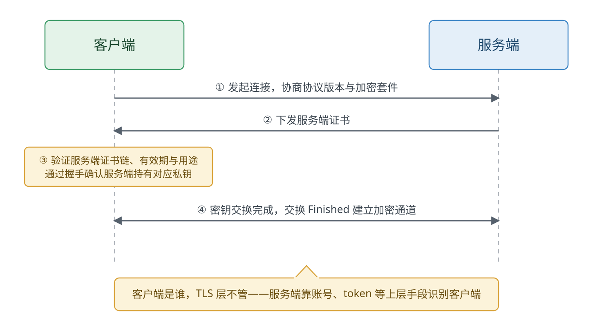
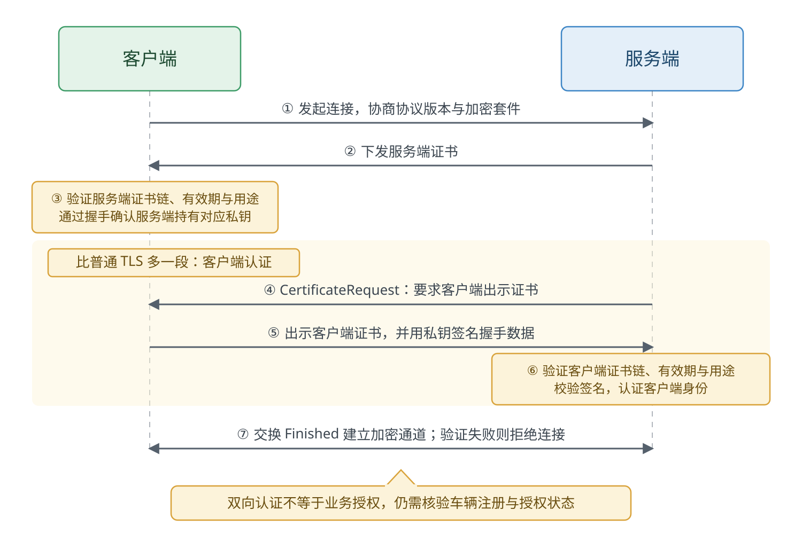
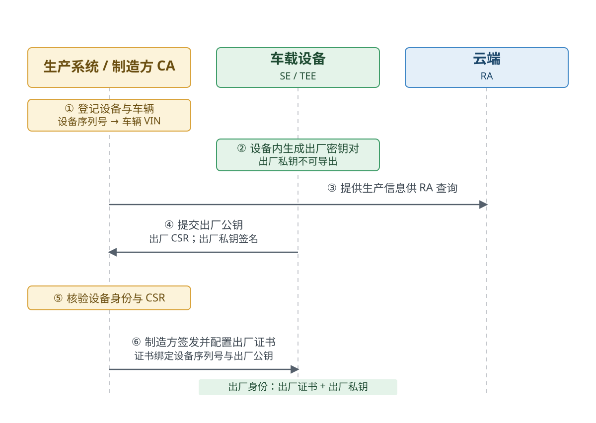
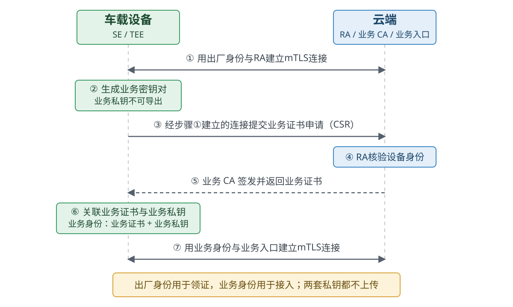
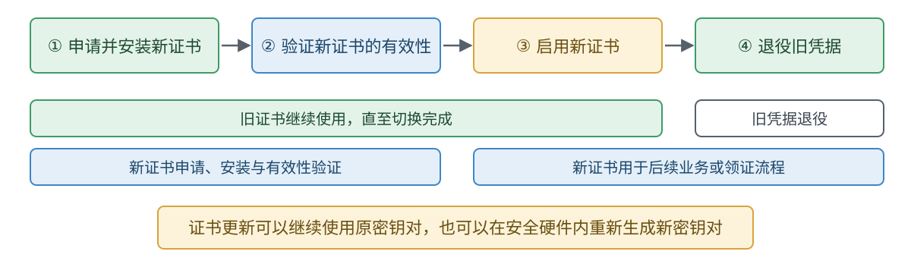

## 1. 背景：TLS 和 mTLS 简介

我们日常打开浏览器访问HTTPS网站，通信过程中使用的安全加密技术就是TLS(Transport Layer Security)。只不过它是单向认证的，客户端只校验服务器的证书，确认访问的是正确的网站，网站并不管你是谁，来者不拒。

但是有些场景下，并不是谁都允许访问服务端的，比如车载场景中，云端部署了一个服务，只给自家的车提供服务，这时候服务端就要核验客户端的身份。这就要用到mTLS（mutual TLS，双向认证 TLS）了，它在TLS中启用了客户端证书认证。

接下来以**TLS 1.2**为例看下TLS和mTLS的交互流程。

### 1.1 TLS：单向认证

TLS（Transport Layer Security，传输层安全，即 HTTPS 底下的加密层）解决两件事：**加密**（防窃听）与**服务端身份认证**（防中间人冒充）。身份认证用到的公钥和私钥是一对密钥，证书由CA（证书颁发机构）签发，它们的关系如下：

| 对象 | 公开性 | 包含什么 | 作用 |
|---|---|---|---|
| 私钥 | 必须保密 | 秘密的密钥数据 | 对握手数据签名 |
| 公钥 | 可以公开 | 与私钥配对的公开密钥 | 验证签名，确认签名由对应私钥产生 |
| 证书 | 可以公开 | 公钥、经审核的身份、有效期、用途等，以及 CA 的签名 | 由 CA 证明这把公钥属于证书中标明的身份 |

证书不包含持有者的私钥。**证书说明公钥属于谁，签名数据证明对方确实拥有对应的私钥**，两者结合才能完成身份认证。在单向认证中，**只有服务端出示证书**，具体流程如下：

1. 客户端发起连接，双方协商协议版本与加密套件；
2. 服务端下发自己的证书；
3. 客户端用预置的信任根证书验证服务端证书链、有效期与用途，并通过后续握手确认服务端持有对应私钥，从而认证服务端身份；
4. 密钥交换完成后建立加密通道。

单向 TLS 不做客户端证书认证，服务端通常靠账号、token 等上层手段识别客户端。不过，可复制的密码或token一旦泄露，别人便可能冒用身份。改用不可导出的客户端私钥、把客户端证书认证加入握手流程，可以减少这类凭据复制风险。这就是 mTLS 的作用。

### 1.2 mTLS：双向认证

mTLS 在普通 TLS 之上多一段客户端认证，具体流程如下：

1. 客户端发起连接，双方协商协议版本与加密套件；
2. 服务端下发自己的证书；
3. 客户端用预置的信任根证书验证服务端证书链、有效期与用途，并通过后续握手确认服务端持有对应私钥，从而认证服务端身份——以上三步与普通 TLS（见 1.1）完全相同；
4. 服务端下发 CertificateRequest，要求客户端出示证书；
5. 客户端回传自己的证书，并用对应私钥签名握手数据——证明"证书是我的，私钥在我手里"，光出示可公开复制的证书不够；
6. 服务端用预置的客户端证书信任根验证客户端证书链、有效期与用途，校验签名，认证客户端身份；
7. 双方都验证通过才建立加密通道，任一步失败都无法建立连接。

> 双向认证只回答"对方持有受信 CA 签发的证书及对应私钥"，不等于业务授权。

### 1.3 TLS 与 mTLS 对比

从以上介绍可以看出，TLS和mTLS差异如下：

| | 普通 TLS | mTLS |
|---|---|---|
| 谁出示证书 | 仅服务端 | 双方 |
| 谁持有私钥 | 仅服务端 | 双方，各用各的私钥 |
| 回答的问题 | "是否持有目标服务器证书对应的私钥" | 额外回答"是否持有受信客户端证书对应的私钥" |
| 客户端身份认证 | 上层账号 / token | 客户端证书 + 私钥签名；上层仍可叠加业务层面的认证与授权 |

> 双方的私钥都不在链路上传输。证书可以公开，但签名验证失败，就不能证明对方持有对应私钥。

---

## 2. 一车一密

前面介绍的 mTLS 能验证客户端证书，并确认对方能使用对应私钥。但云端如何识别和自己通信的是哪一辆车呢？如果所有车辆共用一套客户端凭证（比如一型一密的场景，同一型号的设备用同一套凭证），云端就无法区分。

一车一密就是用来解决这类问题的，它为每辆车配置独立的**客户端证书和私钥**，部署在 TBOX 或车机等车载设备上，这样云端就能识别车辆，进行针对性操作，比如单独停用某辆车的身份而不影响其他车辆。

本文接下来介绍的一车一密方案，采用出厂身份和业务身份分离的方式，二者关系如下：

| 对比项 | 出厂身份 | 业务身份 |
|---|---|---|
| 凭据 | 出厂证书 + 出厂私钥 | 业务证书 + 业务私钥 |
| 用途 | 申请业务证书时认证设备身份 | 业务接入时认证车辆身份 |
| 证书绑定 | 设备序列号与出厂公钥 | 经审核的设备身份与业务公钥 |
| 验证方 | 车厂证书申请审核服务（RA） | 车云通信业务入口 |

上述两套身份彼此独立，其中出厂身份为业务身份做信用背书，好处是不同的业务可以有不同的证书，可以分别授予、吊销。该方案涉及以下模块：

| 模块 | 主要职责 |
|---|---|
| 生产系统 | 登记设备信息，配置出厂身份凭据 |
| 设备上的安全服务 | 生成和保管私钥，提供签名，管理证书 |
| 车厂证书申请审核服务（RA） | 接收业务证书申请，认证设备，核验车辆信息 |
| 业务证书颁发机构（业务 CA） | 根据 RA 的审核结果签发业务证书，发布撤销信息 |
| 车云通信业务入口 | 校验设备身份、访问控制 |

> RA（Registration Authority，注册机构）在车厂 PKI（Public Key Infrastructure，公钥基础设施）中负责申请受理与审核，将通过审核的申请交给 CA（Certificate Authority，证书颁发机构）签发。本文将签发业务证书的 CA 称为**业务 CA**，与 2.1 节签发出厂证书的**制造方 CA**区分。RA 与业务 CA 可由同一套系统承载，也可委托第三方供应商运营。本文后续流程图中将 RA、业务 CA、业务入口放在一起仅为简化，实际部署中三者可能完全独立。

接下来我们看下上述各模块的具体协作流程。

### 2.1 生产过程：建立出厂身份

设备后续申请业务证书时，RA 要确认它是谁。因此，生产阶段需要先为设备建立**出厂身份**，具体流程如下：

1. **登记设备与车辆:** 生产系统登记“设备序列号与车辆VIN”的对应关系。
2. **生成出厂密钥对:** 设备内的安全服务在安全硬件内生成出厂密钥对，出厂私钥留在其中保管、不可导出，后续签名也在其中完成。
3. **提供生产信息供 RA 查询：** 生产系统将生产信息提供给 RA，用于申请业务证书时核验设备身份。
4. **提交出厂公钥:** 设备通过 CSR（Certificate Signing Request，证书签名请求）向生产系统申请出厂证书。CSR 包含出厂公钥、设备序列号等申请信息，并由出厂私钥签名，**不包含私钥**。
5. **核验设备身份与 CSR:** 生产系统验证设备的出厂 CSR 签名，并核对 CSR 中的设备序列号与生产登记信息。
6. **制造方签发并配置出厂证书:** 制造方 CA 签发出厂证书，生产系统将证书安装到设备，与第 2 步生成的出厂私钥关联。

> 安全硬件可以是 SE（Secure Element，安全芯片）或 TEE（Trusted Execution Environment，可信执行环境）。Android系统封装了AndroidKeyStore给开发者使用。

设备出厂后就有了出厂身份，RA 也记录了相关信息。接下来设备可以用出厂身份做背书，申请业务证书。

### 2.2 业务证书申领与接入

设备首次访问云服务时，先用出厂身份申请业务证书，具体流程如下：

1. **用出厂身份与 RA 建立 mTLS 连接:** 连接建立过程中设备出示出厂证书，用出厂私钥签名握手数据；RA 校验证书和签名数据，双方验证通过后建立连接（具体流程参考1.2节的流程）。
2. **生成业务密钥对:** 设备内的安全服务在安全硬件内生成新的业务密钥对，业务私钥不可导出（该密钥对和出厂密钥对完全独立）。
3. **提交业务证书申请:** 设备通过第 1 步建立的 mTLS 连接向 RA 提交业务 CSR，其中包含业务公钥、申请信息和业务私钥的签名数据，**不包含私钥**。
4. **RA 核验设备信息:** RA 从已认证的出厂证书取得设备序列号，查询生产信息，核验车辆归属、领证资格与业务 CSR 签名（这些信息是2.1节第3步提供给RA的）。
5. **业务 CA 签发并返回业务证书:** 业务 CA 根据 RA 的审核结果签发业务证书，绑定设备身份与业务公钥。
6. **关联业务证书与业务私钥:** 设备收到业务证书，与第 2 步生成的业务私钥关联。至此，设备已获得并保存对应业务的身份证明，在证书有效期内可直接使用，无需每次连接都重新申请。
7. **用业务身份接入车云通信业务:** 应用与云服务建立mTLS连接的时候，出示业务证书，并通过安全服务使用业务私钥。

至此，设备已经能和云服务建立安全的通信连接。
不过在实际工程中，我们还要考虑证书的有效期，以及证书临近到期时如何申请新证书。

### 2.3 证书更新

业务证书和出厂证书都有有效期，需要在到期前完成更新。两者的更新路径不同：

| 更新对象 | 申请身份 | 审核与签发 |
|---|---|---|
| 业务证书 | 有效出厂身份 | RA 审核，业务 CA 签发 |
| 出厂证书 | 有效旧出厂身份 | 制造方续期服务审核，制造方 CA 签发 |

> 两类证书的有效期相互独立：出厂证书到期不会使业务证书自动失效，但可能影响设备后续申请业务证书。若 RA 支持，设备也可使用仍有效的旧业务身份申请新证书。

两类证书虽然申请路径不同，但新旧证书的交接顺序相同。**新证书验证通过前，旧证书继续用于原有业务或领证流程：**

1. **申请并安装新证书:** 根据上述表格中的规则，设备使用有效身份申请新证书。证书更新可以继续使用原密钥对，也可以在安全硬件内重新生成新密钥对。设备收到新证书后，将其与对应私钥关联。
2. **验证新证书的有效性:** 按新证书的原定用途建立 mTLS 连接，确认新证书链受信，且对应私钥能够完成握手签名。
3. **启用新证书:** 新证书验证通过后，将后续业务或领证流程切换到新证书。
4. **退役旧凭据:** 切换完成后，旧凭据退役。

上述流程仅适用于旧凭据仍有效的正常更新。异常情况需按以下方式处理：

- **业务私钥泄露:** 业务 CA 吊销旧证书并发布吊销信息，业务入口据此拒绝旧证书；设备安全服务停用旧私钥并生成新密钥对，再使用仍可信的出厂身份向 RA 申请新证书。
- **出厂私钥泄露:** 制造方 CA 可在线吊销旧出厂证书，RA 据此拒绝旧出厂身份；设备安全服务停用旧出厂私钥并生成新密钥对。由于旧出厂私钥已不能证明设备身份，只有预先配置了独立恢复凭据或其他可信通道时才可在线恢复；否则需通过生产、售后等流程重新确认设备与车辆的归属，再恢复出厂身份并申请业务证书。
- **证书到期或被撤销:** 业务证书到期或被撤销时，只要出厂身份仍有效且车辆仍有领证资格，设备即可向 RA 在线申请新证书；出厂证书到期或被撤销时，不能直接凭旧证书在线续期，需通过独立恢复通道重新核验设备身份。

---

## 3. 参考资料

- [Android Keystore 官方文档](https://developer.android.com/privacy-and-security/keystore)——设备内生成和管理密钥、限制密钥使用，以及判断密钥是否由硬件保护。
- [Android Key Attestation 官方文档](https://developer.android.com/privacy-and-security/security-key-attestation)——核验设备密钥的硬件来源与安全属性。
- [EST（RFC 7030）](https://www.rfc-editor.org/rfc/rfc7030.html)——提供证书首次申领与正常换证流程。
- [BRSKI（RFC 8995）](https://www.rfc-editor.org/rfc/rfc8995.html)——使用已建立的出厂身份自动引导设备建立业务身份。
